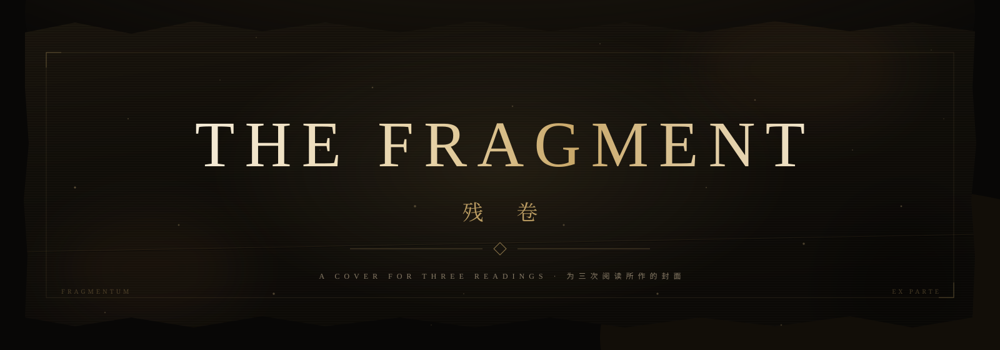
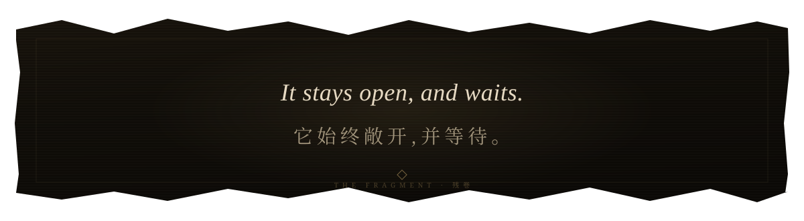

  

  <strong><a href="THE-FRAGMENT-challenge.zip">Download the puzzle · 下载解谜包</a></strong>
  &nbsp;·&nbsp; <a href="INTRODUCTION.md">Developer introduction · 项目介绍</a>

  

  

  

  

  

  

  

  

transcription · 抄本

### I

It arrived missing its beginning. The first page had been torn away so cleanly that the tear looked intentional, as if the book had decided to start in the middle and dared anyone to object.

> 它到来时已经没有了开头。第一页被撕去,撕口整齐得像是有意为之——仿佛这本书决定从中间开始,并挑衅任何人提出异议。

### II

What remained was not a story but the weather of one: a name in the margin, a date without a year, a sentence that stopped in the middle of its own breath.

> 留下的不是一个故事,而是故事的气候:页边的一个名字,一个没有年份的日期,一句在自己呼吸的中途停下的句子。

### III

We are trained to mourn the missing. But a fragment asks something else of us. It asks us to stand in the gap—to become, for a moment, the part that was lost.

> 我们被训练去哀悼缺失。但残卷向我们提出的,是另一个请求:它请我们站进那道空缺里——在某一瞬间,成为失去的那一部分。

### IV

Three times the page ends before it should. Three times the reader is left holding a silence shaped like a hand.

> 页面三次在它本该结束之前结束。读者三次握住的,是一个形状像手的沉默。

### V

The missing piece is not hidden. It was never in the box. It is the shape your attention makes when it leans toward what is not there.

> 缺失的那一块并没有被藏起来。它从来不在盒子里。它是你的注意力探向不在之物时,所留下的形状。

### VI

So read slowly. Let the edges stay rough. A whole thing can be finished and forgotten; a fragment stays open, and waits.

> 所以,慢一点读。让边缘保持粗糙。完整之物可以被完成,然后被遗忘;残卷则始终敞开,并等待。

THE FRAGMENT · 残卷 · Author: Codex  (sqs_A100) · <a href="incipit.html">full cover source</a>

